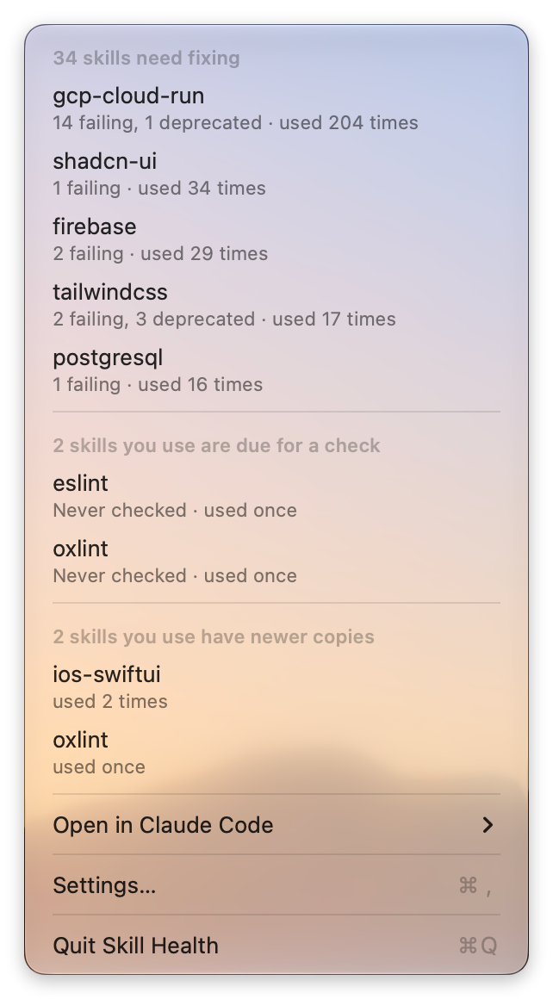

# Skill Health

**Many of the instructions in your agent's skills are no longer true. Skill Health finds them, checks each one against the current documentation of the software it's about, and tells Claude what is true instead.**

Here is a real correction. Claude gets each one as a single line like it, at the start of a session:

> **ai-sdk** says `import { useChat } from "ai/react"`.
> The `ai/react` export was removed in AI SDK 5.0. `useChat` now comes from `@ai-sdk/react`; importing from `ai/react` against the current `ai` package fails.
> Evidence: https://ai-sdk.dev/docs/migration-guides/migration-guide-5-0

Claude gets up to five like it, from the skills you use most. On the author's Mac they come to about 650 tokens.



## Install

**Status: early.** You need macOS 27 and Claude Code (tested with 2.1.285 to 2.1.293). The app is optional and built from source; there's no signed download yet.

```bash
claude plugin marketplace add mvoshell652/skill-health && claude plugin install skill-health@skill-health
```

Then start a Claude Code session. The first one starts the background work (about half a minute the first time, on a long history). From the next one, Claude has the corrections for any skill you use that matches a known correction or that you've checked; run `/skill-health:check` for the rest. A skill you start using later is picked up within a day. Updates aren't automatic for a marketplace like this one. To get new versions and new known corrections, run `claude plugin update skill-health@skill-health`, or open `/plugin`, choose Marketplaces, then skill-health, and enable auto-update; the new version loads in your next session. To stay on a release instead of following `main`, add `#v0.6.1` to the repository name in the first command (quote it in zsh: `'mvoshell652/skill-health#v0.6.1'`). A pinned install gets nothing new, security fixes included, until you move it, and `claude plugin update` will say it is already at the latest version; new versions are listed on the repository's Releases page. A marketplace you already added without it can't be pinned in place; to move to a newer release, run `claude plugin marketplace remove skill-health`, then the install command again with the new `#tag`. Your two options go back to their defaults; `~/.claude/skill-health` isn't touched. The plugin's tool is a prebuilt binary committed to this repository, ad hoc signed and not notarized; [CONTRIBUTING.md](CONTRIBUTING.md) says how to check it against its source.

Claude Code may say two options aren't set yet. The session note and the corrections for Claude are both on by default, so there's nothing to do. To turn one off, use `/plugin configure skill-health`.

## What it does

**The plugin works on its own, with no app.**

- `/skill-health:status` shows, in your session, the skills that need fixing, the ones due for a check and the ones with a newer copy. It runs no check and changes no skill. Claude only reads two short lists, a few thousand tokens in all.
- `/skill-health:check` checks the skills you use, most used first. One agent checks each instruction you could act on (commands, flags, versions, imports, links) against current documentation; a second tries to prove each finding wrong before you see it.
- `/skill-health:fix` goes through failing and deprecated instructions one at a time. You choose: fix the line, set it aside for 30 or 90 days, draft an issue for the skill's author, or name another skill that covers it.
- `/skill-health:update` takes the newer copy of each skill you use, unless you've changed that skill on this Mac.
- `/skill-health:undo` reverses a fix or an update, or reopens a choice you made.

Before a change to a skill is written, Claude Code's permission prompt asks you. For a fix the prompt shows the exact change; for an update it lists the files (a very long list is cut short, and the prompt says so), and the text of each change is in the preview just above it (up to 20,000 characters, and the preview says what it leaves out). A hook, the write gate, refuses Skill Health's apply command while permission prompts are turned off (`bypassPermissions` and `dontAsk`). It reads the command's text, so it is a safeguard, not a sandbox: [SECURITY.md](SECURITY.md) says what it doesn't cover, mode by mode.

At the start of a session the plugin also works out what to tell Claude, in a background process the session never waits for. About once a day it reads which skills you use from Claude Code's session files, your saved checks and what you fixed or set aside, and matches the known corrections. It sends nothing and changes no skill. A correction stops once you fix its instruction with `/skill-health:fix` or set it aside there; if you edit a skill by hand, a correction from your own check goes on until you check it again. Known corrections match a skill's exact file contents, so any change to the file, a fix included, ends the known corrections for that file until you check the skill. `/plugin configure skill-health` turns the one-line note and the corrections off; with both off, nothing runs in the background.

**The app is optional.** A macOS menu bar app shows the same three lists, with a dot on its icon when a skill you use needs a fix, and a page of evidence for each skill, at no token cost. Fixing, checking and updating open in Claude Code. Build it with `Scripts/package_app.sh release`, open `build/SkillHealth.app` and choose your `~/.claude` folder when it asks.

**Which skills.** Every skill in `~/.claude/skills`, however you installed it; the ones you've used in the last 90 days are checked. Skills inside plugins, or in a project's own `.claude/skills`, aren't read. Fixes are written only inside `~/.claude/skills`: a skill folder that links elsewhere, as `npx skills` sets up by default, can be checked but not fixed. Finding newer copies, updating and drafting an issue work only for skills installed from GitHub with openskills.

## What sets it apart

- **Claude gets the corrections, not only you.** Other skill tools change files or write reports. A few add a reminder at session start to run an update, but none tells Claude which instructions are wrong.
- **The evidence is the software's own documentation.** On October 9, 2026, the second agent threw out 15 of 155 findings. The numbers and their dates are in [docs/evidence-and-costs.md](docs/evidence-and-costs.md).
- **Copies already checked cost no tokens.** Known corrections ship with Skill Health and match your skills by exact file contents, so an identical copy shows its wrong instructions without a check. Today there are 89, for 62 checked copies of 61 skills from three collections.
- **Updates never write over your edits.** For skills installed with openskills, a newer copy is taken only when yours is unchanged on this Mac. Every replaced file is backed up, and a fix or update can be reversed while the files are as Skill Health left them.

| If you use | Skill Health adds |
|---|---|
| `gh skill update`, `npx skills update` | Which instructions in your copy are wrong, not only whether the repository has a newer copy |
| Claude Code's `/skill-doctor` and `/doctor prompt-audit` | Each instruction in the skills you use, checked against the documentation of the software it's about |
| `skills-check`, or a skill-audit skill | A source and a second agent on each finding, and corrections Claude gets in every session |
| Context7, or letting Claude look up docs | The wrong instructions in the skills Claude follows, found before it follows them |

The full comparison is in [docs/how-it-compares.md](docs/how-it-compares.md). A check runs on your own Claude plan, with no API key, and asks which skills and what it costs before anything runs; the costs are in [docs/evidence-and-costs.md](docs/evidence-and-costs.md).

## What Skill Health reads, sends and writes

- **Reads** your `~/.claude` folder. The plugin's tool reads it when you run a command and, in the background, at the start of a session (about once a day). The app reads it once you choose it in a folder dialog; it's sandboxed, so it reads only what you choose. To count which skills you use, either one reads Claude Code's session files and keeps skill names, load times and the id of each line it counted, plus each session file's path, size and date so it doesn't read one twice. All of it stays on your Mac.
- **Sends** GitHub the names of the repositories your skills came from, and when you installed them (to find the version you have), through its public API with no account. That starts once you choose Compare Now, and then runs daily while the app is open. When you update, the plugin downloads the new files from `raw.githubusercontent.com` and checks each against the fingerprint GitHub listed for it. A drafted issue reaches GitHub, in the page's address, only if you choose to open it there, and it's posted only if you submit it. A check runs in Claude Code on your plan, so the skills it reads go to Claude as anything else in a session does (and, if you choose "Skills for this project", that project's dependency list, such as package.json), and its agents fetch public documentation pages.
- **Writes** into `~/.claude/skill-health`, which is all the plugin's background work touches, plus a once-a-day stamp in the plugin's own data folder and the app's own settings in its sandbox. Only the plugin changes a skill folder, after you've approved the change; the files it replaces go to `~/.claude/skill-health/backups`. Uninstalling the plugin leaves `~/.claude/skill-health`; delete that folder to remove what the plugin stored. `skill-health issue` puts a drafted issue's text on the clipboard when it is too long for a link.

The privacy policy is [docs/app-store/privacy-policy.md](docs/app-store/privacy-policy.md).

## Limits

- A finding is judged against the software as it is today, not the version your project is set to use. If your project stays on AI SDK 4, `ai/react` still works for it.
- Claude gets the corrections in every project, whether or not that project uses the software they're about.
- The findings' accuracy has been measured only by the second agent so far, not by people reviewing a sample.
- The evidence comes from one person's skills: the 12 in the first check and the 79 on October 9.
- Skill Health works on `~/.claude`. If you point Claude Code at another folder with `CLAUDE_CONFIG_DIR`, the plugin starts nothing in the background, and its commands still read `~/.claude`.

## Contributing

How to build, test and send a change: [CONTRIBUTING.md](CONTRIBUTING.md). In short, `swift build` and `swift test`, on macOS 27 with Swift 6.2 or later and no third-party dependencies. Anything that could change a skill without your approval, or differently from what you were shown: report it privately, as [SECURITY.md](SECURITY.md) says; the write gate's known limit is described there. The design and its reasons are in [docs/2026-10-04_plugin_driven_redesign.md](docs/2026-10-04_plugin_driven_redesign.md).

## License

Apache License 2.0: see [LICENSE](LICENSE) and [NOTICE](NOTICE). `plugin/data/corrections.json` quotes short lines from public skill repositories, to say exactly which line is wrong, and short passages from the documentation that shows it. Each correction names the repository it quotes, and that repository's license covers the quoted text.

Skill Health is an independent project. It isn't affiliated with or endorsed by Anthropic, Apple, GitHub or Google.
